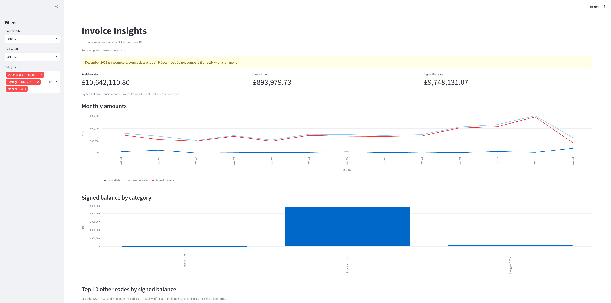

# Invoice Insights

A Python, SQLite and Streamlit portfolio project exploring historical retail
invoice lines, from profiling and documented cleaning to SQL analysis and an
interactive dashboard. It examines how cancellations and special charges change
the picture given by positive sales alone.

## Dashboard preview



## Features

- Profile missing values, exact duplicates and unusual amounts.
- Retain source Excel row references and separate duplicate/review records.
- Analyse positive amounts, cancellation magnitudes and their signed difference.
- Separate known postage codes (DOT/POST) and manual entries (M).
- Filter monthly trends and code rankings; download selected monthly data.

## Run locally on Windows

Developed using Python 3.11. Download the workbook from the
[UCI dataset page](https://archive.ics.uci.edu/dataset/352/online-retail) and save
it as `data/Online Retail.xlsx`. The workbook and generated files are not bundled.
Open this project folder in VS Code and run these commands from its root:

```powershell
python -m venv .venv
.\.venv\Scripts\python.exe -m pip install -r requirements.txt
.\.venv\Scripts\python.exe profile_data.py "data/Online Retail.xlsx"
.\.venv\Scripts\python.exe clean_data.py
.\.venv\Scripts\python.exe analyse_transactions.py
.\.venv\Scripts\python.exe -m streamlit run app.py --server.address localhost
```

If Windows recognises `py`, use `py -3.11 -m venv .venv` for the first command.
No environment activation is needed. Excel parsing can take a minute or more.
Wait for each script to finish before running the next. Open the local URL
printed by Streamlit, usually `http://localhost:8501`. Keep that terminal running;
Ctrl+C stops the app. This does not publish a public website.

On macOS/Linux, create the environment with `python3 -m venv .venv` and replace
`.\.venv\Scripts\python.exe` with `.venv/bin/python` in subsequent commands.

## Files and workflow

| File | Purpose |
| --- | --- |
| `profile_data.py` | Export raw-data diagnostics to `outputs/` |
| `clean_data.py` | Write classified records to `outputs/cleaned/` |
| `analyse_transactions.py` | Build `outputs/analysis_v2/retail_v2.db` and export SQL/CSV reports |
| `app.py` | Read the v2 database and display the dashboard |
| `analyse_sales.py` | Earlier positive-only analysis, retained for comparison |
| `investigate_data.py` | Examine descriptions and examples for DOT, POST and M |
| `check_large_order.py` | Inspect sale/cancellation records for code 23843 |
| `docs/VALIDATION.md` | Observed checks and limitations |

Optional investigations, after cleaning:

```powershell
.\.venv\Scripts\python.exe analyse_sales.py
.\.venv\Scripts\python.exe investigate_data.py
.\.venv\Scripts\python.exe check_large_order.py
```

The dashboard uses the v2 analysis, not the earlier positive-only database.
Re-running scripts replaces derived outputs, never the original workbook.

## Cleaning decisions

Each original row receives one status, with priority duplicate > review >
cancellation > sale. Duplicate detection compares all original columns.

| Status | Rows | Rule |
| --- | ---: | --- |
| Duplicate | 5,268 | Exact duplicate after the first occurrence |
| Review | 2,512 | Invalid invoice/date/quantity/price, zero quantity, non-positive price, or incompatible quantity sign and cancellation prefix |
| Cancellation | 9,251 | Remaining C-prefixed invoices with negative quantity and positive price |
| Sale | 524,878 | Remaining accepted positive-quantity, positive-price lines |
| Total | 541,909 | All original rows accounted for |

Duplicate exclusion is an analytical assumption, not proof of error. Excluded
records are saved separately. Repeated invoice numbers alone are not duplicates:
each row is a line item. Missing customer IDs/descriptions are flagged and retained
when other checks pass. No customer identities are invented. There are 534,129
accepted sale and cancellation lines.

## Metrics and findings

Line amount = quantity × unit price. Positive sales sum accepted sale amounts.
Cancellations sum the magnitudes of accepted negative cancellation amounts.
Signed balance = positive sales − cancellations.

| Full-period metric | GBP |
| --- | ---: |
| Positive sales | 10,642,110.80 |
| Cancellations | 893,979.73 |
| Signed balance | 9,748,131.07 |

Code 23843 has an 80,995-unit sale for GBP 168,469.60 and an equal negative
cancellation 12 minutes later, with the same customer, code and price. These two
accepted records sum to zero, illustrating why positive-only rankings can mislead.
The data does not establish the reason for cancellation.

DOT and POST descriptions identify postage-related entries. M means Manual;
its exact business purpose is unclear. These codes are separated from the other-code
ranking. Remaining codes have not all been verified as merchandise.

## Interpretation limits

- Signed balance is not profit, cash collected or accounting-recognised revenue.
- Cancellations use their recorded dates, not original sale dates. They have not
  all been matched to original orders.
- Coverage is 1 December 2010 to 9 December 2011. December 2011 is incomplete.
- Floating-point amounts are rounded for reporting; this is not a production
  accounting system.
- Downloaded CSVs reflect filters when downloaded and do not update later.
- Streamlit is currently unpinned. Record and pin the version tested in your
  own environment before publishing a reproducible release.

## Source and attribution

Chen, D. (2015). *Online Retail* [Dataset]. UCI Machine Learning Repository.
[DOI: 10.24432/C5BW33](https://doi.org/10.24432/C5BW33).
Dataset licence: [CC BY 4.0](https://creativecommons.org/licenses/by/4.0/).
Generated reports are transformed summaries of this dataset. This is a personal
learning project using public historical data, not client work.
